# Examen práctico U2: permisos de ubicación en Android

| | |
|---|---|
| **Autor** | 2020067576 - Paja de la Cruz, Piero Alexander |
| **Curso** | SI-988 Soluciones Móviles II |
| **Docente** | Dr. Oscar Juan Jimenez Flores |
| **Tipo de examen** | 2 |
| **App** | Pondera, calculadora de promedio ponderado (Flutter + Firebase) |

**Historia de usuario.** Como usuario de la app, quiero que no me pida permisos que no usa, que me pida la ubicación solo cuando voy a usar la función que la necesita, que me explique para qué, y que siga funcionando si respondo que no.

**Documento completo del examen:** [examen/U2.S12.EXAMEN_DE_UNIDAD_-_PRACTICO.md](examen/U2.S12.EXAMEN_DE_UNIDAD_-_PRACTICO.md)

## Contenido

1. [Qué se implementó](#1-qué-se-implementó)
2. [Cómo está hecho](#2-cómo-está-hecho)
3. [Ítem 1: solo los permisos que se usan](#3-ítem-1-solo-los-permisos-que-se-usan)
4. [Ítem 2: permisos separados del resto de la app](#4-ítem-2-permisos-separados-del-resto-de-la-app)
5. [Ítem 3: pedir el permiso sin bloquear la app](#5-ítem-3-pedir-el-permiso-sin-bloquear-la-app)
6. [Ítems 4 y 5: pruebas unitarias](#6-ítems-4-y-5-pruebas-unitarias)
7. [Comandos utilizados](#7-comandos-utilizados)
8. [Lista de cambios y archivos afectados](#8-lista-de-cambios-y-archivos-afectados)

## 1. Qué se implementó

Pondera no usaba la ubicación, así que se agregó el botón **«Usar mi ubicación»** en la pantalla principal, que muestra la latitud y la longitud. Sobre esa función se resolvió cada respuesta posible del usuario:

| Respuesta del usuario | Comportamiento de la app |
|---|---|
| Concede ubicación precisa | Muestra la latitud y la longitud |
| Concede ubicación aproximada | Funciona igual y avisa «Estás usando ubicación aproximada» |
| Toca «Ahora no» o deniega | Permite escribir la ciudad o la dirección y ofrece «Permitir ubicación» |
| Deniega por segunda vez | Mantiene el ingreso manual, ofrece «Abrir ajustes» y no vuelve a solicitar |
| Concede desde Ajustes | Al volver a la app, muestra la ubicación sin tocar nada más |
| GPS apagado o sin lectura | Muestra el error y permite el ingreso manual |

## 2. Cómo está hecho

La solución separa cuatro responsabilidades. Solo la capa inferior conoce las bibliotecas de Android.

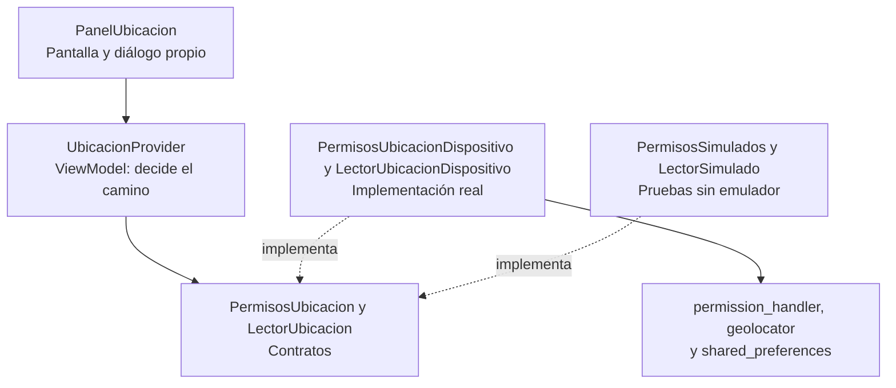

| Capa | Archivo | Responsabilidad |
|---|---|---|
| Vista | `lib/widgets/panel_ubicacion.dart` | Muestra el paso actual y el diálogo propio |
| ViewModel | `lib/providers/ubicacion_provider.dart` | Decide qué hacer según el estado del permiso |
| Modelo | `lib/models/ubicacion.dart` | Define los estados y la entidad `Ubicacion` |
| Contratos | `lib/services/permisos_ubicacion.dart` | Definen qué necesita el ViewModel, sin decir cómo se hace |
| Datos | `lib/services/permisos_ubicacion_dispositivo.dart` | Habla con Android mediante las bibliotecas |

### Flujo al tocar «Usar mi ubicación»

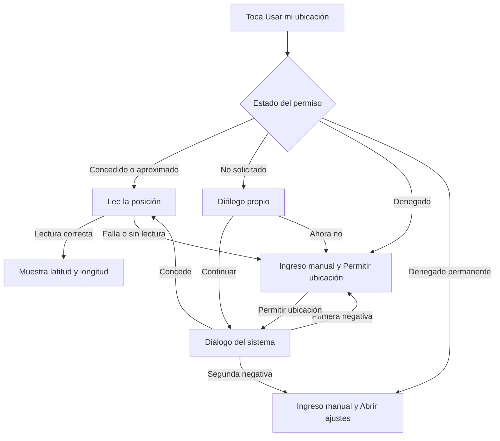

## 3. Ítem 1: solo los permisos que se usan

El manifiesto del proyecto no declaraba permisos propios: los que tenía la app llegaban de las dependencias al fusionar el manifiesto. Por eso se revisó la lista final y no solo el archivo del proyecto.

```xml
<uses-permission android:name="android.permission.ACCESS_COARSE_LOCATION"/>
<uses-permission android:name="android.permission.ACCESS_FINE_LOCATION"/>
<uses-permission
    android:name="com.google.android.providers.gsf.permission.READ_GSERVICES"
    tools:node="remove"/>
```

- **Dos permisos de ubicación:** declarar `COARSE` y `FINE` es lo que permite que Android 12 o superior ofrezca elegir entre precisa y aproximada.
- **`tools:node="remove"`:** indica al fusionador de manifiestos que quite `READ_GSERVICES`, que agregaba una dependencia y ninguna pantalla usa.

| Permiso | Pantalla que lo usa | Momento en que se pide |
|---|---|---|
| `ACCESS_COARSE_LOCATION` | Calculadora rápida | Al tocar «Continuar» o «Permitir ubicación» |
| `ACCESS_FINE_LOCATION` | Calculadora rápida | En el mismo diálogo del sistema |
| `INTERNET` | Login, registro, ciclos y cursos | No se pide: se concede al instalar |
| `ACCESS_NETWORK_STATE` | Login, registro, ciclos y cursos | No se pide: se concede al instalar |
| `DYNAMIC_RECEIVER_NOT_EXPORTED_PERMISSION` | Ninguna: es interno de AndroidX | No se pide: nivel de firma |

**Antes y después del manifiesto:**

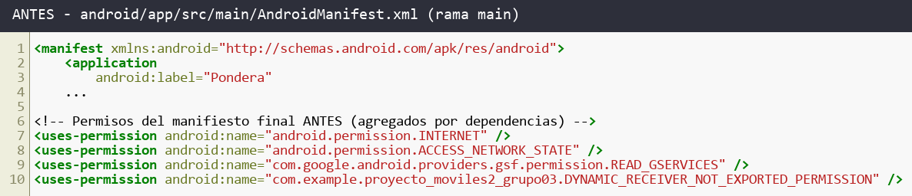

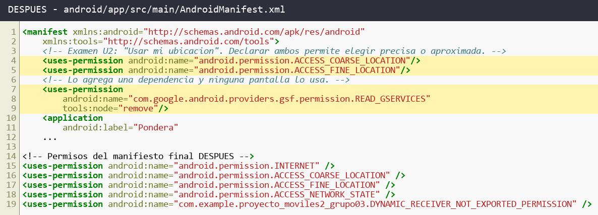

**Permisos en Ajustes.** *Location* es el único permiso que solicita la app. *Nearby devices* no está declarado: Android 17 lo concede a las apps con `INTERNET` y ya aparecía antes de estos cambios.

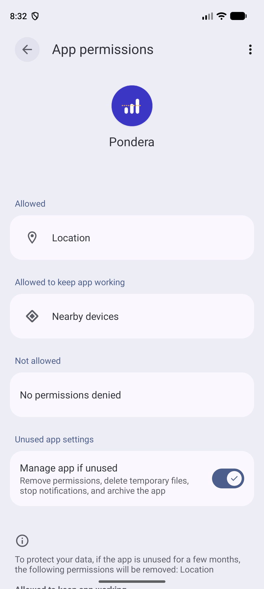

## 4. Ítem 2: permisos separados del resto de la app

La app decide con cinco estados propios, sin depender de los tipos de la biblioteca:

```dart
enum EstadoPermisoUbicacion {
  noSolicitado,
  concedido,
  concedidoAproximado,
  denegado,
  denegadoPermanente,
}
```

El ViewModel recibe el componente por el constructor. Por eso no importa ninguna biblioteca de permisos ni de GPS, y las pruebas pueden entregarle uno simulado:

```dart
class UbicacionProvider extends ChangeNotifier {
  final PermisosUbicacion _permisos;
  final LectorUbicacion _lector;

  UbicacionProvider({
    required PermisosUbicacion permisos,
    required LectorUbicacion lector,
  })  : _permisos = permisos,
        _lector = lector;
```

### Decisiones técnicas

Estas decisiones salen de revisar el código fuente de `permission_handler_android` 14.1.1 y de probar en el emulador.

**1. Detectar el denegado permanente.** Android solo lo informa al solicitar, nunca en una consulta. Por eso el resultado se guarda en el teléfono y sobrevive a reiniciar la app:

```dart
if (respuesta.isPermanentlyDenied) {
  final preferencias = await SharedPreferences.getInstance();
  await preferencias.setBool(_claveDenegadoPermanente, true);
  return EstadoPermisoUbicacion.denegadoPermanente;
}
```

**2. Distinguir «denegado» de «no solicitado».** Android reporta los dos igual. La diferencia se obtiene con `shouldShowRequestRationale`, que es verdadero después de la primera negativa:

```dart
final yaDenego = await Permission.location.shouldShowRequestRationale;
return yaDenego ? EstadoPermisoUbicacion.denegado : EstadoPermisoUbicacion.noSolicitado;
```

**3. Detectar la ubicación aproximada.** Con solo `COARSE` concedido, `permission_handler` responde `denied` porque evalúa `FINE`. Por eso se confirma con `geolocator`:

```dart
final precision = await Geolocator.getLocationAccuracy();
return precision == LocationAccuracyStatus.reduced
    ? EstadoPermisoUbicacion.concedidoAproximado
    : EstadoPermisoUbicacion.concedido;
```

**4. Leer la posición.** Se usa `forceLocationManager: true` para evitar un diálogo adicional de precisión de Google Play Services. Se pide precisión alta porque con precisión media el GPS del emulador no llegaba a activarse. Si no llega una lectura en 10 segundos, se usa la última posición conocida.

**Función con el permiso concedido.** Las coordenadas son de Tacna, fijadas en el emulador, porque un emulador no tiene GPS real.

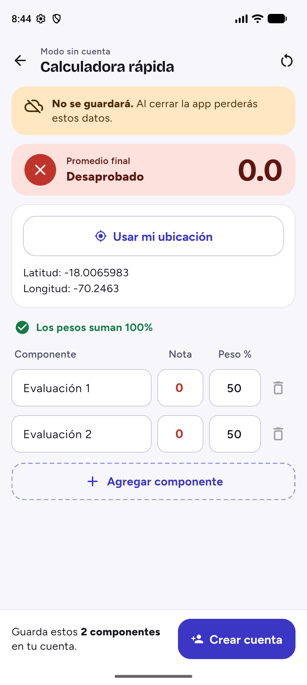

## 5. Ítem 3: pedir el permiso sin bloquear la app

El constructor del ViewModel no consulta ni solicita nada, por lo que la app abre sin diálogos. Todo empieza cuando el usuario toca la función:

```dart
Future<void> tocarFuncion() async {
  _error = null;
  _estado = await _permisos.consultar();
  switch (_estado) {
    case EstadoPermisoUbicacion.concedido:
    case EstadoPermisoUbicacion.concedidoAproximado:
      await _ejecutar();
    case EstadoPermisoUbicacion.noSolicitado:
      _irA(PasoUbicacion.explicacion);
    case EstadoPermisoUbicacion.denegado:
      _irA(PasoUbicacion.ingresoManual);
    case EstadoPermisoUbicacion.denegadoPermanente:
      _irA(PasoUbicacion.abrirAjustes);
  }
}
```

`tocarFuncion()` nunca llama a `solicitar()`. Esa llamada solo ocurre por «Continuar» en el diálogo propio o por «Permitir ubicación». Así se garantiza que la app no insiste después de una negativa.

Al volver de Ajustes, el panel escucha el ciclo de vida de la app con `WidgetsBindingObserver` y llama a `alVolverALaApp()`, que revisa de nuevo el permiso.

| 1. Diálogo propio | 2. Diálogo del sistema | 3. Ingreso manual |
|---|---|---|
| 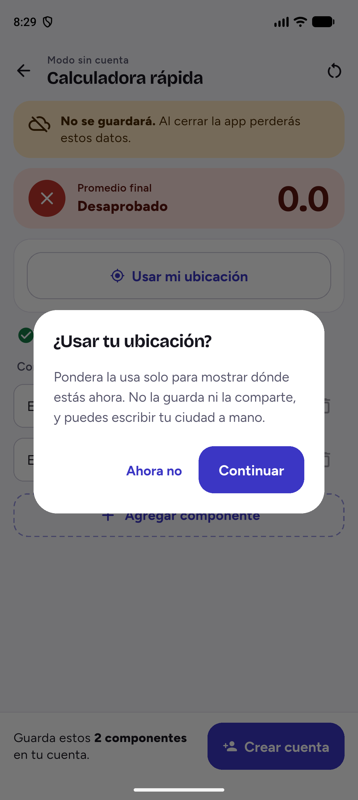 | 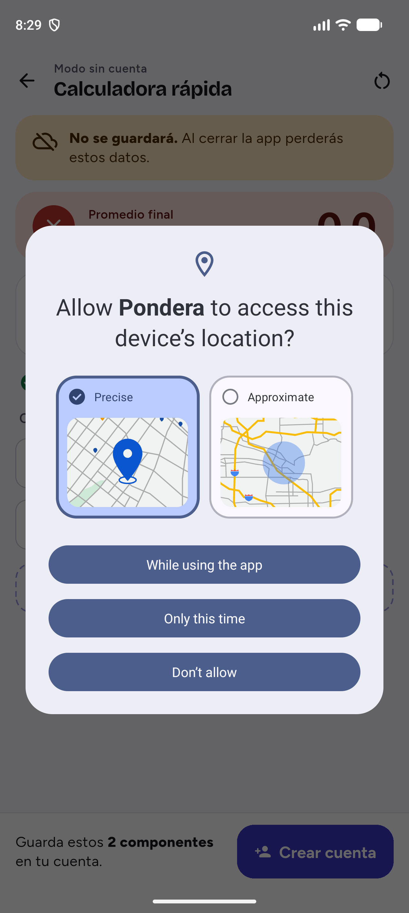 | 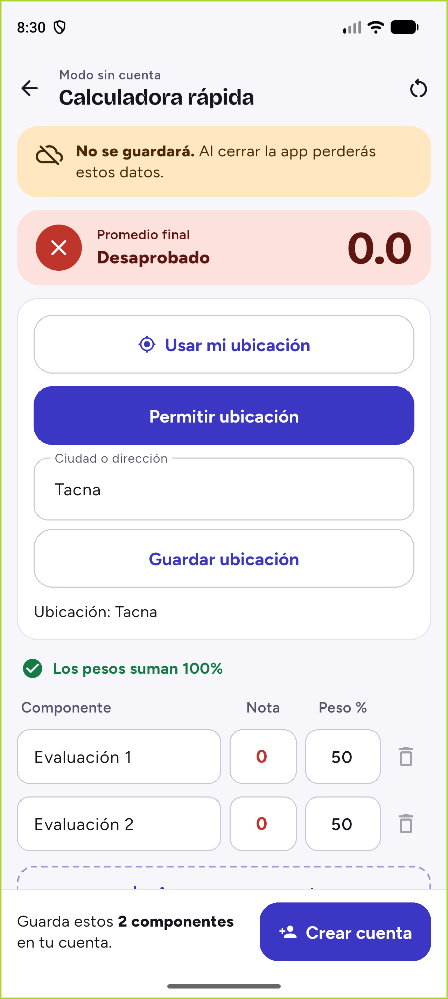 |
| Explica para qué se usa la ubicación antes de pedirla | Permite elegir entre precisa y aproximada | Tras denegar, la función sigue disponible a mano |

| 4. Oferta de abrir ajustes | 5. Ubicación aproximada |
|---|---|
| 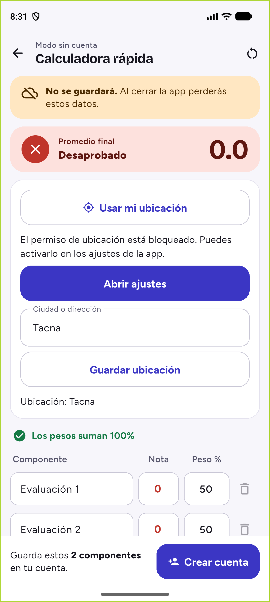 | 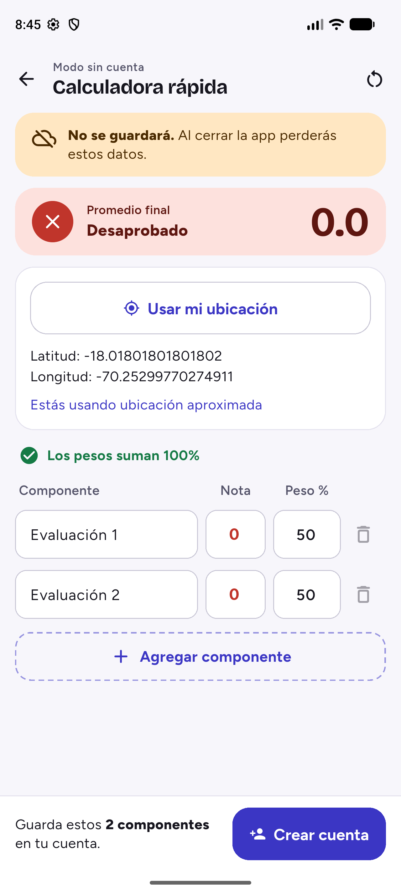 |
| Tras la segunda negativa ya no se solicita el permiso | La función se ejecuta con la posición reducida por Android |

## 6. Ítems 4 y 5: pruebas unitarias

Las pruebas corren sin emulador porque `PermisosSimulados` reemplaza al componente real. Responde el estado que indica cada prueba y cuenta las solicitudes:

```dart
class PermisosSimulados implements PermisosUbicacion {
  EstadoPermisoUbicacion estado;
  final EstadoPermisoUbicacion respuestaSolicitud;
  int solicitudes = 0;

  PermisosSimulados(this.estado, {EstadoPermisoUbicacion? respuestaSolicitud})
      : respuestaSolicitud = respuestaSolicitud ?? estado;

  @override
  Future<EstadoPermisoUbicacion> consultar() async => estado;

  @override
  Future<EstadoPermisoUbicacion> solicitar() async {
    solicitudes++;
    estado = respuestaSolicitud;
    return estado;
  }

  @override
  Future<void> abrirAjustes() async {}
}
```

| Ítem | Prueba | Qué comprueba |
|---|---|---|
| 4 | (a) | Al crear el ViewModel, `solicitudes` y `lecturas` quedan en 0 |
| 4 | (b) | Con permiso concedido se lee la posición y no se solicita |
| 4 | (c) | Con denegado permanente se ofrecen los ajustes y no se solicita |
| 5 | (a) | Con ubicación aproximada se lee la posición y `esAproximada` es verdadero |
| 5 | (b) | Si deniega y vuelve a tocar, `solicitudes` queda en 1 |

La prueba 5 (b) recorre el caso real de no insistir:

```dart
await provider.tocarFuncion();
await provider.continuarExplicacion();
await provider.tocarFuncion();

expect(permisos.solicitudes, 1);
expect(provider.paso, PasoUbicacion.ingresoManual);
```

**Resultado del ítem 4:**

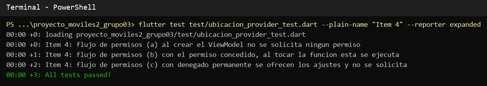

**Resultado del ítem 5:**

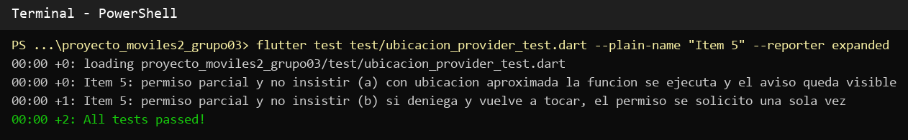

## 7. Comandos utilizados

Salvo que se indique otra cosa, se ejecutan en PowerShell desde `proyecto_moviles2_grupo03/`.

### Preparar el entorno

Gradle 8.14 no es compatible con Java 25, así que Flutter se configuró con un JDK 17:

```powershell
flutter config --jdk-dir="C:\Users\HP\.jdks\jbr-17.0.14"
```

`adb` no está en el PATH, así que se creó un alias para la sesión:

```powershell
Set-Alias adb "$env:LOCALAPPDATA\Android\Sdk\platform-tools\adb.exe"
$app = "com.example.proyecto_moviles2_grupo03"
```

### Agregar las dependencias

```powershell
flutter pub add permission_handler geolocator shared_preferences
```

### Analizar el código y ejecutar las pruebas

```powershell
flutter analyze lib test
flutter test test/ubicacion_provider_test.dart --plain-name "Item 4" --reporter expanded
flutter test test/ubicacion_provider_test.dart --plain-name "Item 5" --reporter expanded
flutter test
```

| Comando | Resultado |
|---|---|
| `flutter analyze lib test` | Sin problemas |
| Pruebas del ítem 4 | 3 aprobadas |
| Pruebas del ítem 5 | 2 aprobadas |
| `flutter test` | 100 aprobadas en todo el proyecto |

### Compilar e instalar en el emulador

```powershell
flutter build apk --debug
adb install -r build\app\outputs\flutter-apk\app-debug.apk
```

### Demostrar la app

Borrar los datos y permisos para repetir el flujo como una instalación nueva:

```powershell
adb shell pm clear $app
```

Abrir la app:

```powershell
adb shell monkey -p $app -c android.intent.category.LAUNCHER 1
```

Fijar la ubicación en Tacna. Se envía justo después de conceder el permiso, porque el GPS del emulador solo la toma mientras la app está leyendo:

```powershell
adb emu geo fix -70.2463 -18.0066
```

Abrir los ajustes de la app:

```powershell
adb shell am start -a android.settings.APPLICATION_DETAILS_SETTINGS -d package:$app
```

Revisar qué permisos tiene concedidos la app:

```powershell
adb shell dumpsys package $app | Select-String "ACCESS_(FINE|COARSE)_LOCATION: granted"
```

## 8. Lista de cambios y archivos afectados

**Cambios:**

- Se agregó el botón «Usar mi ubicación» en la pantalla principal.
- Se declararon los permisos de ubicación precisa y aproximada, y se quitó `READ_GSERVICES`.
- El permiso se modela con cinco estados propios de la app.
- El ViewModel recibe el componente de permisos desde fuera y no importa las bibliotecas.
- El permiso se pide al tocar la función, después de un diálogo propio con «Continuar» y «Ahora no».
- Si no se concede, la función sigue disponible escribiendo la ciudad o la dirección.
- Si queda denegado permanentemente, la app ofrece abrir sus ajustes y no vuelve a solicitarlo.
- Con ubicación aproximada, la función se ejecuta y muestra el aviso.
- Se agregaron cinco pruebas unitarias del flujo de permisos.

**Archivos**, con rutas dentro de `proyecto_moviles2_grupo03/`:

| Archivo | Cambio |
|---|---|
| `android/app/src/main/AndroidManifest.xml` | Permisos de ubicación y retiro de `READ_GSERVICES` |
| `android/gradle.properties` | Ajustes agregados por la herramienta de Flutter |
| `pubspec.yaml`, `pubspec.lock` | `permission_handler`, `geolocator` y `shared_preferences` |
| `lib/main.dart` | Registro de `UbicacionProvider` con las implementaciones reales |
| `lib/models/ubicacion.dart` | Nuevo: estados del permiso y entidad `Ubicacion` |
| `lib/services/permisos_ubicacion.dart` | Nuevo: contratos de permisos y lectura de ubicación |
| `lib/services/permisos_ubicacion_dispositivo.dart` | Nuevo: implementación con las bibliotecas |
| `lib/providers/ubicacion_provider.dart` | Nuevo: ViewModel del flujo |
| `lib/widgets/panel_ubicacion.dart` | Nuevo: panel de la función y diálogo propio |
| `lib/screens/home_screen.dart` | Muestra el panel en la pantalla principal |
| `test/ubicacion_provider_test.dart` | Nuevo: pruebas de los ítems 4 y 5 |
| `test/widget_test.dart` | Registra el nuevo provider |
