**UNIVERSIDAD PRIVADA DE TACNA**

**FACULTAD DE INGENIERÍA**

**ESCUELA DE INGENIERÍA DE SISTEMAS**

{width="1.4173217410323709in"
height="1.4802318460192476in"}

**EXAMEN PRÁCTICO DE LA UNIDAD II**

**CURSO:**

**SI-988 SOLUCIONES MÓVILES II**

**AUTOR:**

2020067576 - PAJA DE LA CRUZ, PIERO ALEXANDER

**URL GITHUB:**

<https://github.com/pieroalexanderppc/EXAMEN_U2_SOLUCIONESMOVILES2>

**TIPO DE EXAMEN: 2**

**DOCENTE:**

DR. OSCAR JUAN JIMENEZ FLORES

TACNA --- PERÚ

# Indicaciones

-   El docente le asigna un único tipo de examen (1, 2, 3 o 4).
    Desarrolle exclusivamente el tipo asignado y márquelo claramente en
    la carátula.

-   Trabajará sobre la app móvil de su proyecto con los avances de los
    Sprints culminados en la unidad 2, y desplegada en el emulador o en
    un dispositivo físico propio. El login de la Unidad I debe seguir
    siendo funcional y la app debe mostrar ya datos de su lógica de
    negocio. La calificación se centra en el código cliente (Mobile
    App).

-   La evidencia será un único archivo PDF nombrado obligatoriamente
    SI988-EXPRAC-U2-ApellidoNombre.pdf y subido al Aula Virtual.

-   El documento debe incluir el desarrollo paso a paso de cada ítem de
    su tipo de examen, con capturas legibles del entorno de desarrollo,
    del emulador o dispositivo y de la terminal, más una breve
    explicación técnica de lo implementado.

-   Suba todo el código fuente con los cambios implementados a su
    repositorio individual de GitHub, llamada examen-u2. En el README.md
    detalle el tipo de examen y la lista de cambios y los archivos del
    proyecto móvil afectados.

-   El uso de herramientas de IA está permitido bajo su estricta
    responsabilidad. No se admitirá atribución de errores a la IA y el
    estudiante debe dominar y explicar técnicamente cada línea de
    código.

-   No copie código de talleres ni de compañeros. Las clases, vistas,
    entidades y paquetes deben corresponder a su propio proyecto, y cada
    ítem se aplica a una funcionalidad real de su app, no a una pantalla
    de demostración aislada. Cualquier detección de plagio o código
    duplicado anulará la evaluación sin lugar a reclamo.

-   *[Al concluir su desarrollo, deberá convocar al docente para la
    validación en tiempo real de todos los puntos programados y pruebas
    ejecutadas en su computador.]{.mark}*


  -----------------------------------------------------------------------
  **TIPO DE EXAMEN 2**
  -----------------------------------------------------------------------

  -----------------------------------------------------------------------

**Historia de usuario.** *Como usuario de la app, quiero que no me pida
permisos que no usa, que me pida la ubicación solo cuando voy a usar la
función que la necesita, que me explique para qué, y que siga
funcionando si respondo que no.*

## Resumen de la solución

La app de mi proyecto es **Pondera**, una calculadora de promedio ponderado desarrollada en Flutter con Firebase. Como no usaba la ubicación, agregué en la pantalla principal el botón **«Usar mi ubicación»**, que muestra la latitud y la longitud. Sobre esa función resolví cada respuesta posible del usuario:

| Respuesta del usuario | Comportamiento de la app |
|---|---|
| Concede ubicación precisa | Muestra la latitud y la longitud |
| Concede ubicación aproximada | Funciona igual y avisa «Estás usando ubicación aproximada» |
| Toca «Ahora no» o deniega | Permite escribir la ciudad o la dirección y ofrece «Permitir ubicación» |
| Deniega por segunda vez | Mantiene el ingreso manual, ofrece «Abrir ajustes» y no vuelve a solicitar |
| Concede desde Ajustes | Al volver a la app, muestra la ubicación sin tocar nada más |
| GPS apagado o sin lectura | Muestra el error y permite el ingreso manual |

La solución separa las responsabilidades en capas. Solo la capa de datos conoce las bibliotecas de Android:

| Capa | Archivo | Responsabilidad |
|---|---|---|
| Vista | `lib/widgets/panel_ubicacion.dart` | Muestra el paso actual y el diálogo propio |
| ViewModel | `lib/providers/ubicacion_provider.dart` | Decide qué hacer según el estado del permiso |
| Modelo | `lib/models/ubicacion.dart` | Define los estados y la entidad `Ubicacion` |
| Contratos | `lib/services/permisos_ubicacion.dart` | Definen qué necesita el ViewModel, sin decir cómo se hace |
| Datos | `lib/services/permisos_ubicacion_dispositivo.dart` | Habla con Android mediante las bibliotecas |

Las bibliotecas agregadas cumplen funciones distintas: `permission_handler` consulta y solicita el permiso, `geolocator` lee la posición e indica la precisión concedida, y `shared_preferences` recuerda en el teléfono el denegado permanente.


+-----------------------------------------------------------------------+
| **1. Deje solo los permisos que su app usa (4 puntos)**               |
|                                                                       |
| **Objetivo.** *La app declara únicamente los permisos que alguna      |
| pantalla necesita, todo este tipo de examen trabaja con el permiso de |
| ubicación.*                                                           |
|                                                                       |
| **Tarea 1.** Elija la función de su app que usa la ubicación. Si no   |
| tiene ninguna, agregue en la pantalla principal el botón «Usar mi     |
| ubicación», que muestra la latitud y la longitud.                     |
|                                                                       |
| **Tarea 2.** El manifiesto declara solo los permisos que alguna       |
| pantalla usa.                                                         |
|                                                                       |
| **Tarea 3.** En el diálogo del sistema el usuario puede elegir entre  |
| ubicación precisa y aproximada.                                       |
|                                                                       |
| **Evidencia de la app.** Captura de Ajustes del emulador, en          |
| Aplicaciones, su app, Permisos, con solo los permisos que quedaron.   |
|                                                                       |
| **Evidencia del código.** Captura del manifiesto antes y después, y   |
| una tabla con tres columnas (permiso, pantalla que lo usa y momento   |
| en que se pide).                                                      |
+=======================================================================+
+-----------------------------------------------------------------------+

## Desarrollo del ítem 1

Pondera no usaba la ubicación, por lo que se aplicó la Tarea 1: se agregó el botón **«Usar mi ubicación»** en la pantalla principal (`HomeScreen`, Calculadora rápida), que muestra la latitud y la longitud.

El manifiesto del proyecto no declaraba permisos propios: los que tenía la app llegaban de las dependencias al fusionar el manifiesto. Se revisó esa lista final y se hicieron dos cambios:

- Se declararon `ACCESS_COARSE_LOCATION` y `ACCESS_FINE_LOCATION`. Declarar los dos es lo que permite que Android 12 o superior ofrezca elegir entre ubicación precisa y aproximada.
- Se quitó `READ_GSERVICES` con `tools:node="remove"`, porque lo agregaba una dependencia y ninguna pantalla lo usa.

**Paso a paso.**

1. Busqué en el código si alguna pantalla usaba la ubicación. Como ninguna la usaba, agregué el botón en `HomeScreen` mediante el widget `PanelUbicacion`.
2. Revisé el manifiesto final generado por la compilación, porque ahí aparecen también los permisos de las dependencias.
3. Declaré los dos permisos de ubicación en `AndroidManifest.xml`.
4. Quité el permiso que ninguna pantalla usa.
5. Compilé e instalé la app, y comprobé el resultado en Ajustes y en el diálogo del sistema.

Estas son las líneas agregadas al manifiesto:

```xml
<uses-permission
    android:name="android.permission.ACCESS_COARSE_LOCATION"/>
<uses-permission
    android:name="android.permission.ACCESS_FINE_LOCATION"/>
<uses-permission
    android:name="com.google.android.providers.gsf.permission.READ_GSERVICES"
    tools:node="remove"/>
```

El atributo `tools:node="remove"` indica al fusionador de manifiestos que elimine ese permiso aunque una dependencia lo declare. Para usarlo también se agregó el espacio de nombres `xmlns:tools` en la etiqueta `manifest`.

**Evidencia de la app: permisos en Ajustes.** Solo aparece *Location* como permiso solicitado. *Nearby devices* no está declarado por la app: el dispositivo ya lo mostraba antes de estos cambios, porque Android 17 lo concede automáticamente a las apps con `INTERNET`.

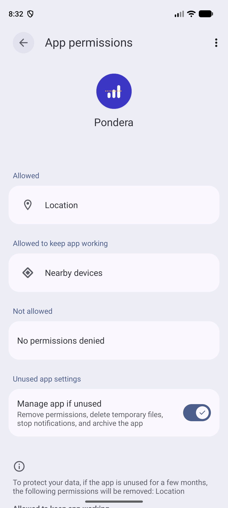{width="3in"}

**Evidencia de la app: elección de precisión.** El diálogo del sistema ofrece *Precise* y *Approximate*.

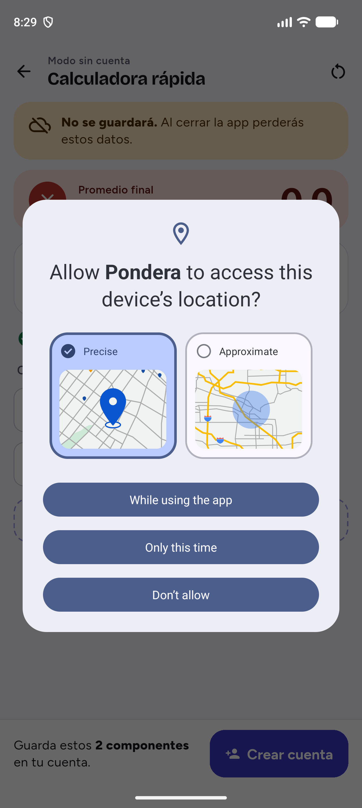{width="3in"}

**Evidencia del código: manifiesto antes y después.**

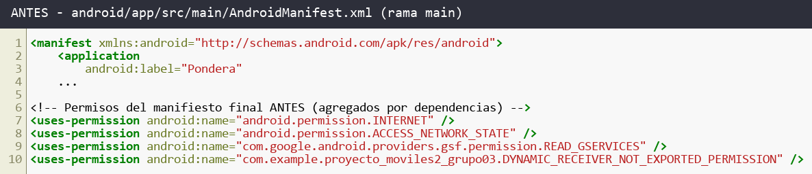{width="6.2in"}

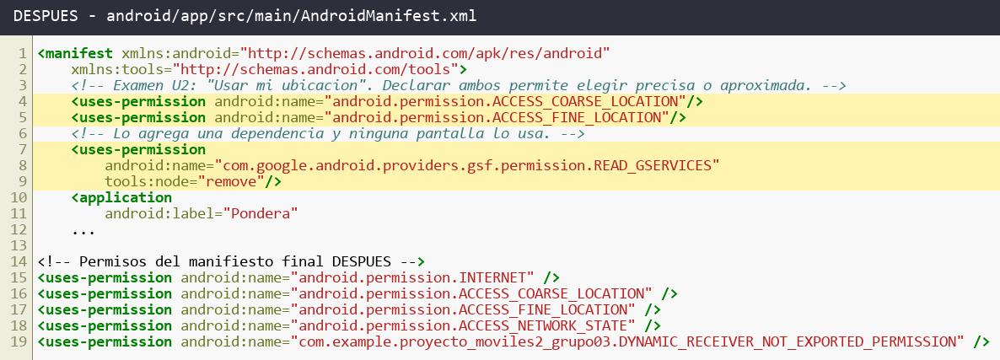{width="6.2in"}

**Tabla de permisos.**

| Permiso | Pantalla que lo usa | Momento en que se pide |
|---|---|---|
| `ACCESS_COARSE_LOCATION` | Calculadora rápida, «Usar mi ubicación» | Al tocar «Continuar» en el diálogo propio o «Permitir ubicación» |
| `ACCESS_FINE_LOCATION` | Calculadora rápida, «Usar mi ubicación» | Junto con el anterior, en el mismo diálogo del sistema |
| `INTERNET` | Login, registro, ciclos y cursos (Firebase) | No se pide: Android lo concede al instalar |
| `ACCESS_NETWORK_STATE` | Login, registro, ciclos y cursos (Firebase) | No se pide: Android lo concede al instalar |
| `DYNAMIC_RECEIVER_NOT_EXPORTED_PERMISSION` | Ninguna: es interno de AndroidX, propio de la app | No se pide: nivel de firma, no visible para el usuario |


+-----------------------------------------------------------------------+
| **2. Separe los permisos del resto de la app (4 puntos)**             |
|                                                                       |
| **Objetivo.** *El ViewModel decide con estados propios de la app y no |
| depende de la biblioteca de permisos, de modo que pueda probarse sin  |
| emulador.*                                                            |
|                                                                       |
| **Tarea 1.** La app distingue cinco estados del permiso de ubicación, |
| no solicitado, concedido, concedido solo aproximado, denegado y       |
| denegado permanentemente.                                             |
|                                                                       |
| **Tarea 2.** El ViewModel recibe desde fuera el componente que        |
| consulta y solicita el permiso, y no importa la biblioteca de         |
| permisos.                                                             |
|                                                                       |
| **Evidencia de la app.** Captura de la función de ubicación           |
| funcionando con el permiso concedido.                                 |
|                                                                       |
| **Evidencia del código.** Captura de los estados, del componente de   |
| permisos y de los imports del ViewModel.                              |
+=======================================================================+
+-----------------------------------------------------------------------+

## Desarrollo del ítem 2

- **Estados propios.** `EstadoPermisoUbicacion` define los cinco estados pedidos. Ni el ViewModel ni la pantalla conocen los tipos de las bibliotecas.
- **Componente de permisos.** `PermisosUbicacion` es el contrato y `PermisosUbicacionDispositivo` su implementación real, único archivo que importa `permission_handler` y `geolocator`.
- **ViewModel.** `UbicacionProvider` recibe el componente por el constructor y `main.dart` le entrega la implementación real.

Dos decisiones técnicas salen del código fuente de `permission_handler_android` 14.1.1:

- Android no distingue «denegado permanente» en una consulta, solo al solicitar. Por eso ese resultado se guarda con `shared_preferences`, y «denegado» se distingue de «no solicitado» con `shouldShowRequestRationale`.
- Con solo ubicación aproximada, el plugin responde `denied` porque evalúa `FINE`. Por eso el estado concedido se obtiene con `Geolocator.checkPermission()` y `getLocationAccuracy()`.

**Paso a paso.**

1. Definí en `lib/models/ubicacion.dart` el enum `EstadoPermisoUbicacion` con los cinco estados.
2. Creé en `lib/services/permisos_ubicacion.dart` los contratos `PermisosUbicacion` y `LectorUbicacion`.
3. Implementé esos contratos en `lib/services/permisos_ubicacion_dispositivo.dart`.
4. Creé `UbicacionProvider`, que recibe los contratos por su constructor.
5. Registré el ViewModel en `main.dart` con las implementaciones reales.

Esta inyección por constructor es lo que hace posible probar el ViewModel sin emulador:

```dart
UbicacionProvider({
  required PermisosUbicacion permisos,
  required LectorUbicacion lector,
})  : _permisos = permisos,
      _lector = lector;
```

`main.dart` es el único punto que conecta el ViewModel con la implementación real:

```dart
ChangeNotifierProvider(
  create: (context) => UbicacionProvider(
    permisos: PermisosUbicacionDispositivo(),
    lector: LectorUbicacionDispositivo(),
  ),
),
```

Así se obtiene cada estado en la capa de datos:

```dart
// Denegado permanente: se recuerda en el telefono.
if (respuesta.isPermanentlyDenied) {
  final preferencias = await SharedPreferences.getInstance();
  await preferencias.setBool(_claveDenegadoPermanente, true);
  return EstadoPermisoUbicacion.denegadoPermanente;
}
```

```dart
// Aproximada: geolocator informa la precision concedida.
final precision = await Geolocator.getLocationAccuracy();
return precision == LocationAccuracyStatus.reduced
    ? EstadoPermisoUbicacion.concedidoAproximado
    : EstadoPermisoUbicacion.concedido;
```

Para leer la posición se usa `forceLocationManager: true`, que evita un diálogo adicional de precisión de Google Play Services. Se pide precisión alta porque con precisión media el GPS del emulador no llegaba a activarse. Si no llega una lectura en 10 segundos, se usa la última posición conocida.

**Evidencia de la app: función con el permiso concedido.** Coordenadas de Tacna fijadas en el emulador con `adb emu geo fix -70.2463 -18.0066`.

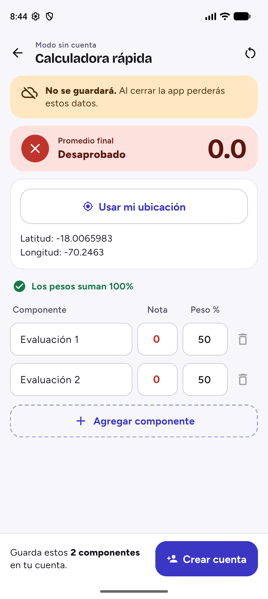{width="3in"}

**Evidencia del código: estados.**

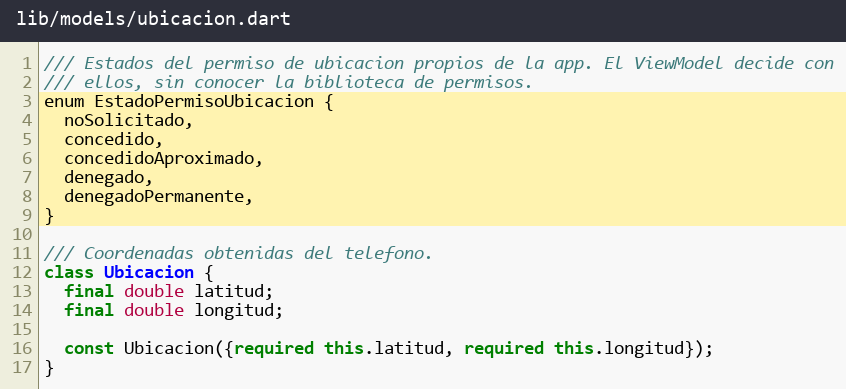{width="6.2in"}

**Evidencia del código: componente de permisos.**

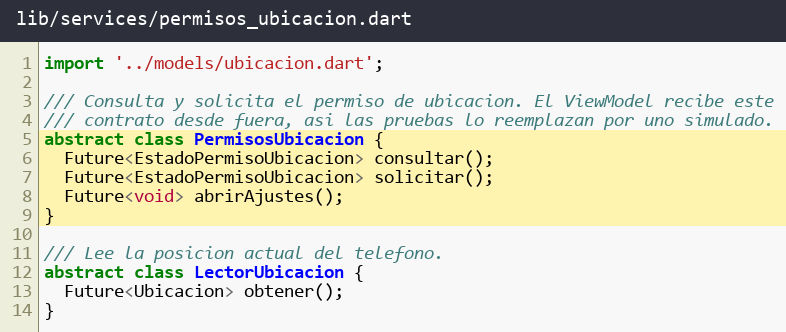{width="6.2in"}

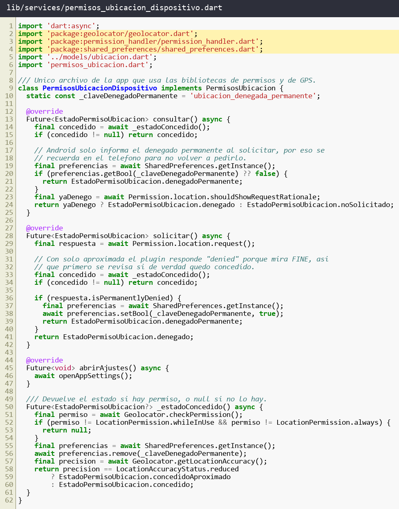{width="6.2in"}

**Evidencia del código: imports del ViewModel.** No importa `permission_handler` ni `geolocator`.

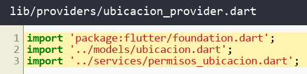{width="6.2in"}


+-----------------------------------------------------------------------+
| **3. Pida el permiso al tocar el botón y no bloquee la app (4         |
| puntos)**                                                             |
|                                                                       |
| **Objetivo.** *El permiso se pide en el momento de usar la función y  |
| la app tiene una salida para cada respuesta.*                         |
|                                                                       |
| **Tarea 1.** La app no pide ningún permiso al abrirse.                |
|                                                                       |
| **Tarea 2.** La primera vez que el usuario toca la función, un        |
| diálogo propio explica para qué se usa la ubicación antes del diálogo |
| del sistema, con las opciones «Continuar» y «Ahora no».               |
|                                                                       |
| **Tarea 3.** Si el usuario no concede el permiso, la función sigue    |
| disponible escribiendo la ciudad o la dirección a mano, y el botón    |
| «Permitir ubicación» vuelve a solicitarlo solo cuando el usuario lo   |
| toca.                                                                 |
|                                                                       |
| **Tarea 4.** Si el permiso queda denegado permanentemente, la app     |
| ofrece abrir sus ajustes y no vuelve a solicitarlo. En el emulador se |
| llega a este estado denegando, tocando «Permitir ubicación» y         |
| denegando otra vez.                                                   |
|                                                                       |
| **Tarea 5.** Con ubicación aproximada, la función se ejecuta igual y  |
| muestra «Estás usando ubicación aproximada».                          |
|                                                                       |
| **Evidencia de la app.** Cinco capturas en este orden, el diálogo     |
| propio, el diálogo del sistema, el ingreso manual tras denegar, la    |
| oferta de abrir ajustes y el aviso de ubicación aproximada.           |
|                                                                       |
| **Evidencia del código.** Captura del código del ViewModel que elige  |
| cada camino.                                                          |
+=======================================================================+
+-----------------------------------------------------------------------+

## Desarrollo del ítem 3

La app no pide ningún permiso al abrirse: `UbicacionProvider` no hace nada en su constructor y la bienvenida carga sin diálogos. El flujo empieza solo en `tocarFuncion()`.

| Situación | Camino | Método |
|---|---|---|
| Primera vez | Diálogo propio y luego diálogo del sistema | `tocarFuncion`, `continuarExplicacion` |
| Concedido o aproximado | Ejecuta la función | `_ejecutar` |
| Denegado | Ingreso manual y «Permitir ubicación» | `tocarFuncion`, `permitirUbicacion` |
| Denegado permanente | Ingreso manual y «Abrir ajustes» | `abrirAjustes` |

Si el GPS está apagado o no llega lectura, la función también pasa al ingreso manual, y al volver de Ajustes `alVolverALaApp()` revisa de nuevo el permiso.

**Paso a paso.**

1. `UbicacionProvider` empieza en el paso `inicial` y su constructor no llama a ningún método de permisos.
2. Al tocar el botón, `PanelUbicacion` llama a `tocarFuncion()`, que consulta el estado y elige el camino.
3. Si el paso es `explicacion`, el panel muestra el diálogo propio.
4. «Continuar» llama a `continuarExplicacion()`, que abre el diálogo del sistema. «Ahora no» lleva al ingreso manual.
5. Según la respuesta, `_solicitar()` ejecuta la función, pasa al ingreso manual u ofrece los ajustes.
6. Al volver de Ajustes, `alVolverALaApp()` consulta de nuevo el permiso y, si fue concedido, ejecuta la función.

Este es el método central del flujo:

```dart
Future<void> tocarFuncion() async {
  _error = null;
  _estado = await _permisos.consultar();
  switch (_estado) {
    case EstadoPermisoUbicacion.concedido:
    case EstadoPermisoUbicacion.concedidoAproximado:
      await _ejecutar();
    case EstadoPermisoUbicacion.noSolicitado:
      _irA(PasoUbicacion.explicacion);
    case EstadoPermisoUbicacion.denegado:
      _irA(PasoUbicacion.ingresoManual);
    case EstadoPermisoUbicacion.denegadoPermanente:
      _irA(PasoUbicacion.abrirAjustes);
  }
}
```

Este método nunca llama a `solicitar()`. Esa llamada solo ocurre por «Continuar» o por «Permitir ubicación», y por eso la app no insiste después de una negativa. Además, `permitirUbicacion()` revisa primero si el permiso quedó denegado permanentemente: en ese caso ofrece los ajustes y no solicita.

Para detectar el regreso desde Ajustes, el panel escucha el ciclo de vida de la app:

```dart
@override
void didChangeAppLifecycleState(AppLifecycleState state) {
  if (state == AppLifecycleState.resumed) {
    context.read<UbicacionProvider>().alVolverALaApp();
  }
}
```

**App recién abierta.** Pantalla principal con el botón, sin ningún diálogo de permisos.

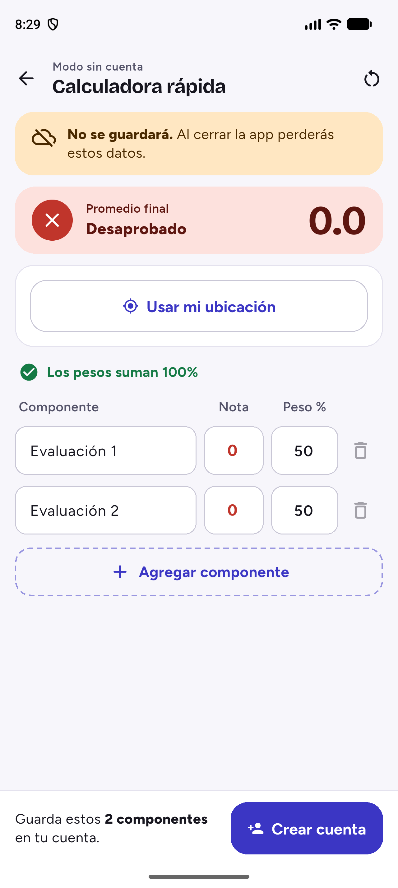{width="3in"}

**1. Diálogo propio**, con «Continuar» y «Ahora no».

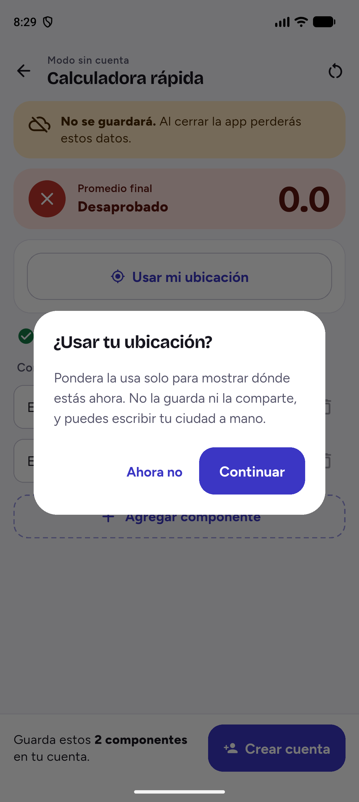{width="3in"}

**2. Diálogo del sistema.**

{width="3in"}

**3. Ingreso manual tras denegar.** La función sigue disponible escribiendo la ciudad.

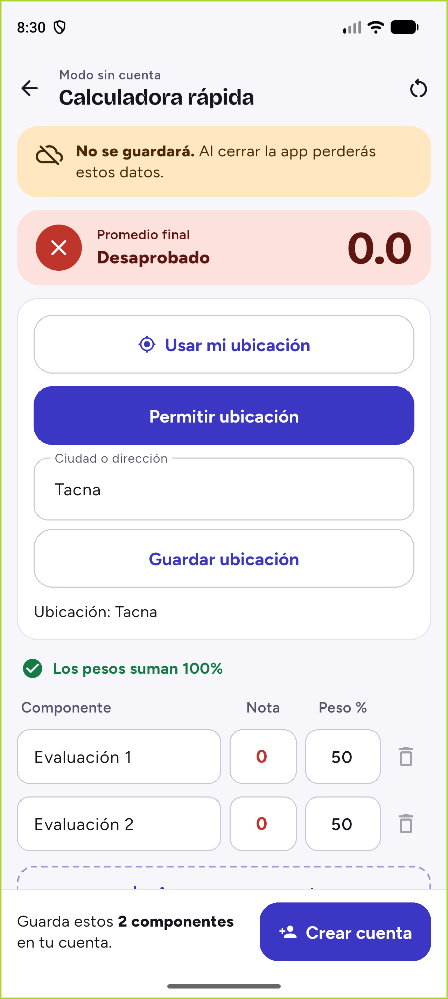{width="3in"}

**4. Oferta de abrir ajustes.** Se llegó denegando, tocando «Permitir ubicación» y denegando otra vez. Tras reiniciar la app, tocar la función siguió mostrando esta oferta sin abrir el diálogo del sistema.

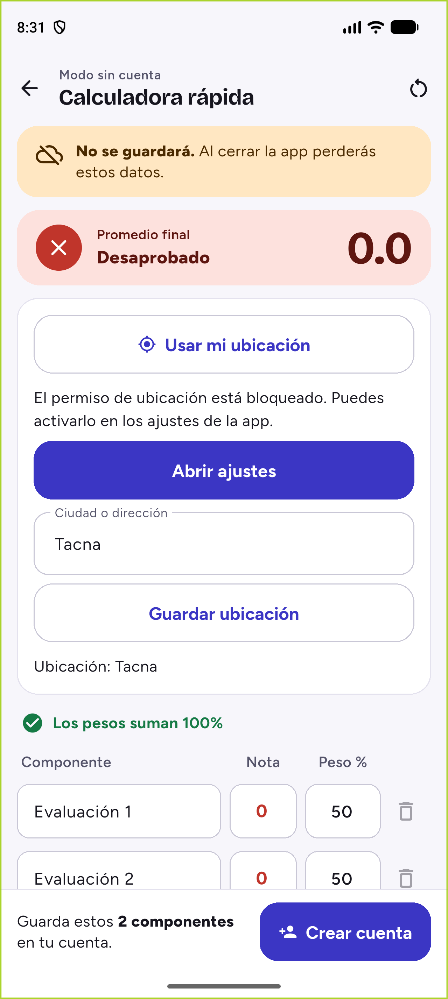{width="3in"}

**5. Aviso de ubicación aproximada.** La función se ejecuta igual, con la posición reducida por Android.

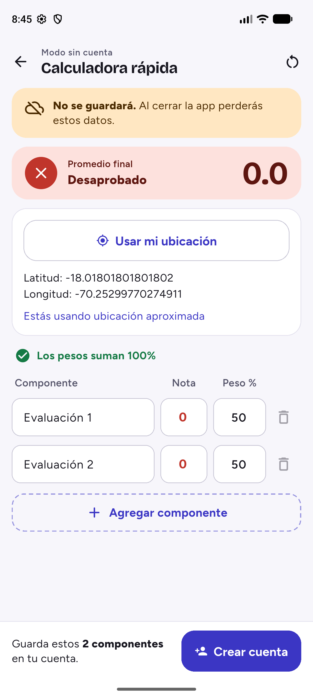{width="3in"}

**Evidencia del código: ViewModel que elige cada camino.**

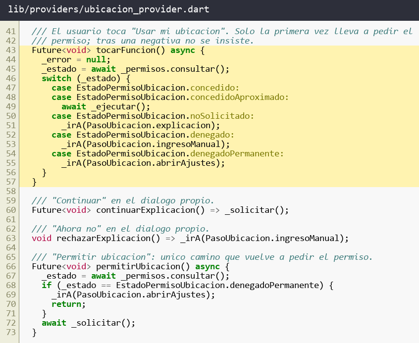{width="6.2in"}

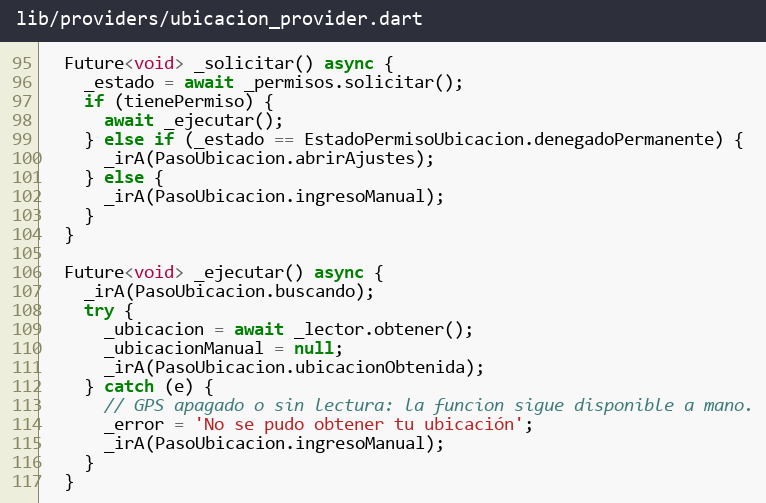{width="6.2in"}


+-----------------------------------------------------------------------+
| **4. Ejecute tres pruebas unitarias del flujo de permisos (4          |
| puntos)**                                                             |
|                                                                       |
| **Objetivo.** *Se comprueba el ViewModel sin emulador, reemplazando   |
| el componente de permisos por uno simulado.*                          |
|                                                                       |
| **Tarea 1.** Prueba (a). Al crear el ViewModel no se solicita ningún  |
| permiso.                                                              |
|                                                                       |
| **Tarea 2.** Prueba (b). Con el permiso concedido, al tocar la        |
| función esta se ejecuta.                                              |
|                                                                       |
| **Tarea 3.** Prueba (c). Con el permiso denegado permanentemente, al  |
| tocar la función se ofrece abrir los ajustes y no se solicita el      |
| permiso.                                                              |
|                                                                       |
| **Tarea 4.** Ejecute las pruebas desde la terminal.                   |
|                                                                       |
| **Evidencia de la terminal.** Captura con el comando ejecutado y el   |
| resultado de todas las pruebas en verde (PASS).                       |
|                                                                       |
| **Evidencia del código.** Captura de las pruebas y del reemplazo      |
| simulado que usan.                                                    |
+=======================================================================+
+-----------------------------------------------------------------------+

## Desarrollo del ítem 4

`PermisosSimulados` reemplaza al componente real: responde el estado que indica cada prueba y cuenta las solicitudes en `solicitudes`. `LectorSimulado` reemplaza al GPS y cuenta las lecturas. Así las pruebas corren sin emulador.

| Prueba | Preparación | Qué comprueba |
|---|---|---|
| (a) | Permiso no solicitado | Al crear el ViewModel, `solicitudes` y `lecturas` quedan en 0 |
| (b) | Permiso concedido | Se lee la posición, se exponen las coordenadas y no se solicita |
| (c) | Denegado permanente | El paso es `abrirAjustes`, y no hay solicitudes ni lecturas |

Cada prueba sigue tres partes: prepara el simulado con un estado, ejecuta la acción sobre el ViewModel y verifica con `expect`. Los contadores permiten comprobar no solo lo que la app hizo, sino también lo que **no** hizo.

Comando ejecutado desde `proyecto_moviles2_grupo03`:

```powershell
flutter test test/ubicacion_provider_test.dart `
  --plain-name "Item 4" --reporter expanded
```

**Evidencia de la terminal.**

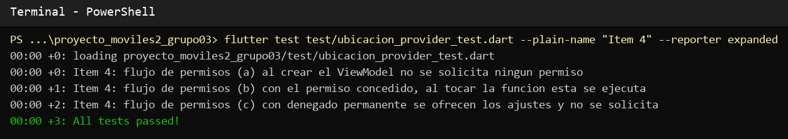{width="6.2in"}

**Evidencia del código: reemplazo simulado.**

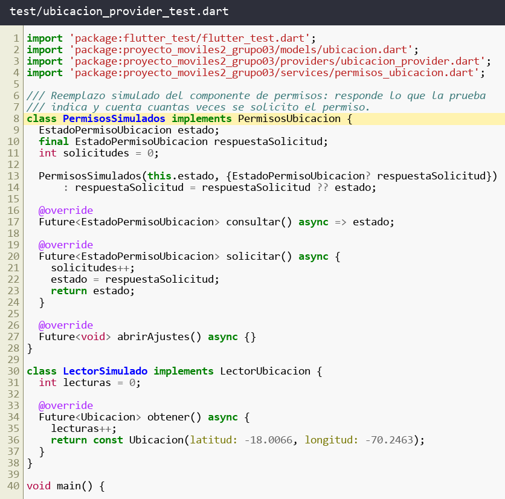{width="6.2in"}

**Evidencia del código: pruebas.**

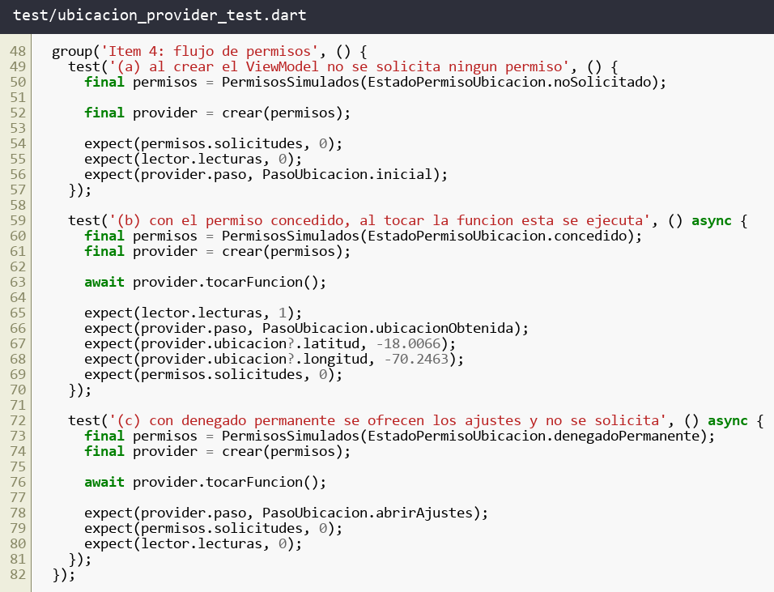{width="6.2in"}


+-----------------------------------------------------------------------+
| **5. Ejecute dos pruebas unitarias del permiso parcial y de no        |
| insistir (4 puntos)**                                                 |
|                                                                       |
| **Objetivo.** *Se comprueba que la app funciona con lo que recibe y   |
| no vuelve a pedir lo que el usuario negó.*                            |
|                                                                       |
| **Tarea 1.** Prueba (a). Con ubicación aproximada, la función se      |
| ejecuta y el aviso queda visible.                                     |
|                                                                       |
| **Tarea 2.** Prueba (b). Si el usuario deniega el permiso y vuelve a  |
| tocar la función, el permiso se solicitó una sola vez.                |
|                                                                       |
| **Tarea 3.** Ejecute las pruebas desde la terminal.                   |
|                                                                       |
| **Evidencia de la terminal.** Captura con el comando ejecutado y el   |
| resultado de todas las pruebas en verde (PASS).                       |
|                                                                       |
| **Evidencia del código.** Captura de las pruebas y del reemplazo      |
| simulado que usan.                                                    |
+=======================================================================+
+-----------------------------------------------------------------------+

## Desarrollo del ítem 5

- **Prueba (a).** Con `concedidoAproximado` la lectura se ejecuta y `esAproximada` queda en verdadero, que es la condición con la que la pantalla muestra «Estás usando ubicación aproximada».
- **Prueba (b).** El usuario toca la función, continúa, deniega y vuelve a tocar. `solicitudes` queda en 1 porque `tocarFuncion()` no solicita con el estado denegado: solo «Permitir ubicación» vuelve a pedirlo.

La prueba (b) recorre el caso real de no insistir: primera solicitud, negativa y nuevo toque de la función.

```dart
await provider.tocarFuncion();
await provider.continuarExplicacion();
await provider.tocarFuncion();

expect(permisos.solicitudes, 1);
expect(provider.paso, PasoUbicacion.ingresoManual);
```

Comando ejecutado desde `proyecto_moviles2_grupo03`:

```powershell
flutter test test/ubicacion_provider_test.dart `
  --plain-name "Item 5" --reporter expanded
```

**Evidencia de la terminal.**

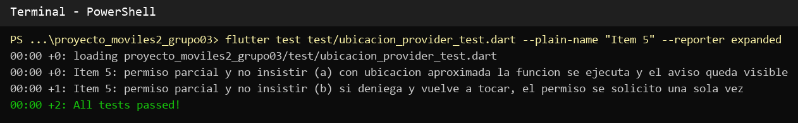{width="6.2in"}

**Evidencia del código: pruebas.** Usan el mismo reemplazo simulado mostrado en el ítem 4.

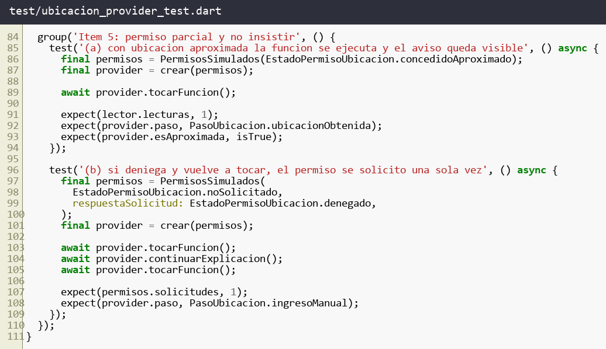{width="6.2in"}

# Comandos utilizados

Salvo que se indique otra cosa, se ejecutaron en PowerShell desde `proyecto_moviles2_grupo03`.

**Preparar el entorno.** Gradle 8.14 no es compatible con Java 25, por lo que Flutter se configuró con un JDK 17. `adb` no está en el PATH, así que se creó un alias para la sesión.

```powershell
flutter config --jdk-dir="C:\Users\HP\.jdks\jbr-17.0.14"
Set-Alias adb "$env:LOCALAPPDATA\Android\Sdk\platform-tools\adb.exe"
$app = "com.example.proyecto_moviles2_grupo03"
```

**Agregar las dependencias.**

```powershell
flutter pub add permission_handler geolocator shared_preferences
```

**Analizar y probar.** El análisis terminó sin problemas y `flutter test` aprobó las 100 pruebas del proyecto.

```powershell
flutter analyze lib test
flutter test
```

**Compilar e instalar en el emulador.**

```powershell
flutter build apk --debug
adb install -r build\app\outputs\flutter-apk\app-debug.apk
```

**Repetir el flujo como una instalación nueva.** Borra los datos y permisos de la app, y la vuelve a abrir.

```powershell
adb shell pm clear $app
adb shell monkey -p $app -c android.intent.category.LAUNCHER 1
```

**Fijar la ubicación en Tacna.** Un emulador no tiene GPS real. El comando se envía justo después de conceder el permiso, porque el GPS del emulador solo toma la posición mientras la app está leyendo.

```powershell
adb emu geo fix -70.2463 -18.0066
```

**Abrir los ajustes de la app y revisar los permisos concedidos.**

```powershell
adb shell am start `
  -a android.settings.APPLICATION_DETAILS_SETTINGS `
  -d package:$app
adb shell dumpsys package $app |
  Select-String "ACCESS_(FINE|COARSE)_LOCATION: granted"
```

# Archivos del proyecto móvil afectados

Las rutas están dentro de `proyecto_moviles2_grupo03`.

| Archivo | Cambio |
|---|---|
| `android/app/src/main/AndroidManifest.xml` | Permisos de ubicación y retiro de `READ_GSERVICES` |
| `android/gradle.properties` | Ajustes agregados por la herramienta de Flutter |
| `pubspec.yaml`, `pubspec.lock` | `permission_handler`, `geolocator` y `shared_preferences` |
| `lib/main.dart` | Registro de `UbicacionProvider` |
| `lib/models/ubicacion.dart` | Nuevo: estados del permiso y entidad `Ubicacion` |
| `lib/services/permisos_ubicacion.dart` | Nuevo: contratos |
| `lib/services/permisos_ubicacion_dispositivo.dart` | Nuevo: implementación con las bibliotecas |
| `lib/providers/ubicacion_provider.dart` | Nuevo: ViewModel del flujo |
| `lib/widgets/panel_ubicacion.dart` | Nuevo: panel y diálogo propio |
| `lib/screens/home_screen.dart` | Muestra el panel en la pantalla principal |
| `test/ubicacion_provider_test.dart` | Nuevo: pruebas de los ítems 4 y 5 |
| `test/widget_test.dart` | Registra el nuevo provider |
